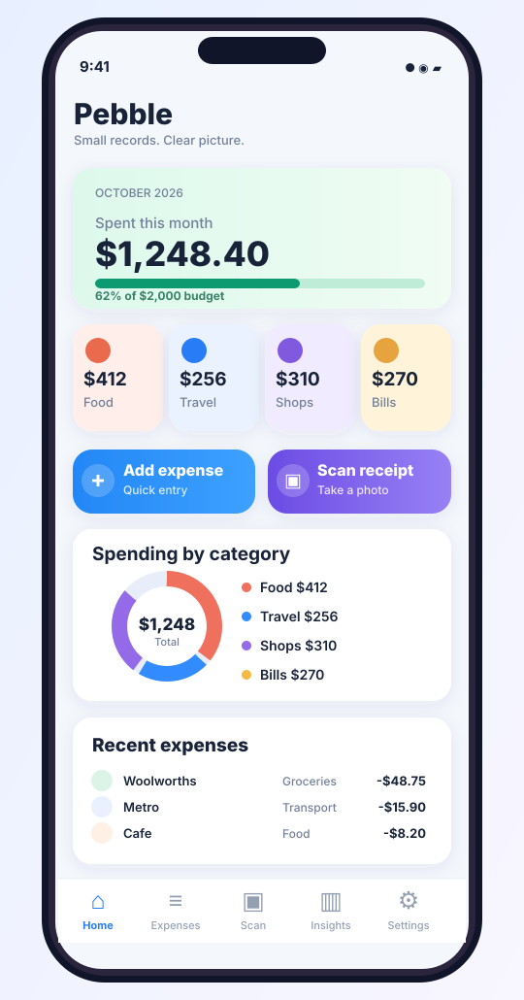
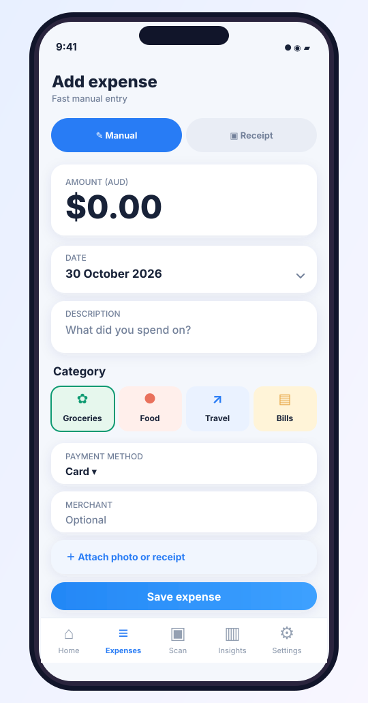
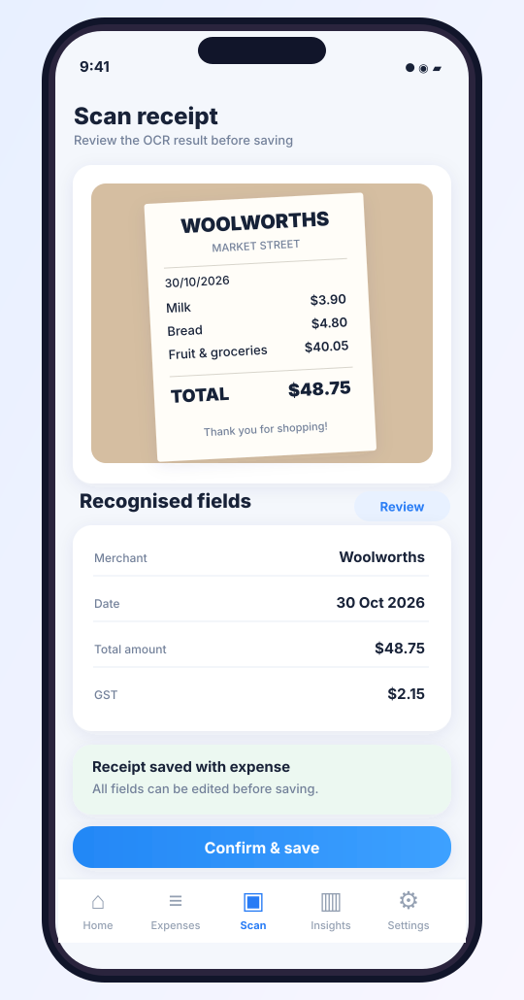
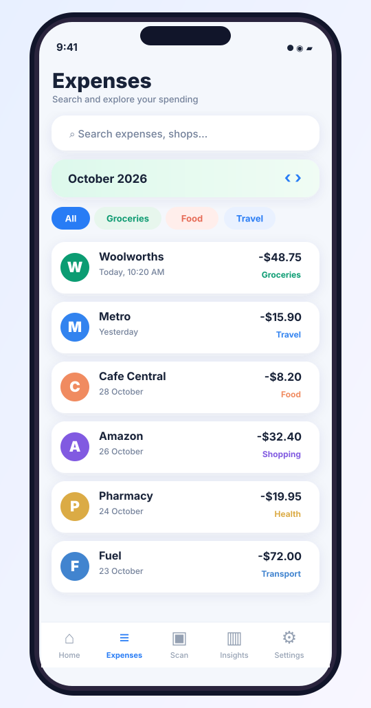
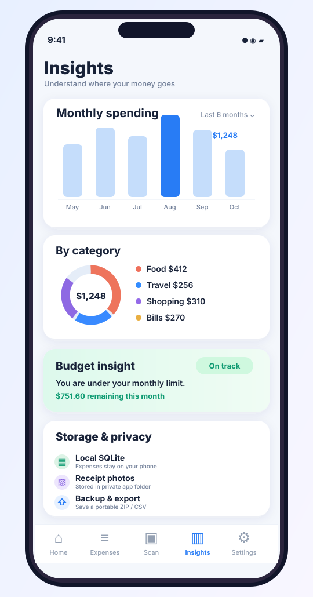

# Pebble — UI mockups

These five **scalable SVG mockups** show the intended Flutter experience. They are design references, not screenshots of a built app. Use the [full specification](../Pebble_Design_and_Build_Specification.md) for behaviour, validation, accessibility and acceptance criteria.

All sample expenses are illustrative, with **AUD** currency and Australian-style dates. Desktop and dark-mode designs are future variations.

## 1. Home / spending dashboard

**Design intent:** Monthly totals at a glance, category tiles, recent activity and one-tap shortcuts to manual entry or scanning.

## 2. Add expense / manual entry

**Design intent:** Date, amount and description are required; everything else can be supplied later. Keep amount entry prominent and saving friction-free.

## 3. Scan and review receipt

**Design intent:** Capture/import an image, perform on-device text recognition, and present editable extracted fields. Never save uncertain OCR values without confirmation.

## 4. Expenses / history

**Design intent:** Search, date/category filters, readable spending records, receipt attachment state and detail navigation.

## 5. Insights / storage

**Design intent:** Spending trends and category summaries alongside control over private local data, backups and exports.

---

### Design-to-build notes

- **Navigation:** Home, Expenses, Scan, Insights and Settings.
- **Visual style:** soft surfaces, generous spacing, calm pastels, strong typography, crisp status colours and subtle pebble forms.
- **Interaction:** Support small screens, system text scaling, keyboard/screen-reader navigation and reduced motion.
- **Data safety:** SQLite is the source of truth for expenses; images are saved in the app's private storage, referenced by relative paths; full ZIP backup includes both.
- **Scope:** SVGs show representative happy paths. The specification defines the error states, permissions, empty screens, confirmation flows and operational constraints.

Individual SVGs are plain text and may be revised in code or opened in common vector graphics tools.
